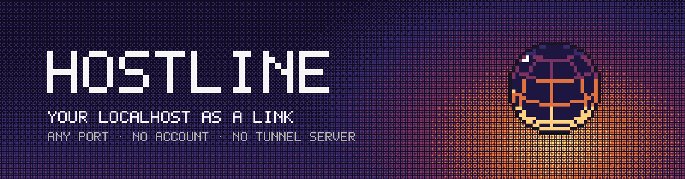

<p align="center">
  <picture>
    <source media="(prefers-reduced-motion: reduce)" srcset="assets/banner.png">
    
  </picture>
</p>

<p align="center">
  <a href="#use-it"><b>Use it</b></a> ·
  <a href="#install">Install</a> ·
  <a href="#how-it-works">How it works</a>
</p>

```
hostline 5173
```

I wanted my friends to test what I'm building without me deploying it, and to open it on my phone
without putting the phone and the computer on the same Wi-Fi. So Hostline prints a link and a QR code. Whoever opens the
link gets that port in their browser, loaded straight from your machine. They install nothing and
make no account, and there's no tunnel server carrying your traffic. The link ends when you stop
Hostline.

It works for any port, not only dev servers: `vite`, `next dev`, `next start`, a `vite preview`, a
Python `http.server`, an API with a page in front of it.

## Use it

1. Start whatever you want to share, as you normally would.
2. Run `hostline` with its port: `hostline 3000`. With no port, Hostline looks at the usual ones
   (3000, 5173, 8080 and a dozen more) and shares the one that's listening.
3. The link is already copied. Paste it anywhere, or point your phone's camera at the QR code.

Each person who opens it shows up in your terminal (`● Safari on iPhone opened the link`). Hot
reload works through the link: you save, their page updates.

`hostline --for 30m` ends the link after 30 minutes (`s`, `m` and `h` work). Without it, the link
lasts until you press Ctrl+C. Either way, every page that has it open says the link ended, and the
next run gets a new link.

## Install

On Linux or macOS:

```
curl -fsSL https://hostline.luannzin.com/install.sh | sh
```

On Windows, in PowerShell:

```
irm https://hostline.luannzin.com/install.ps1 | iex
```

With Node, there's nothing to install: `npx hostline 3000`.

Installed copies keep themselves up to date: when a new version is out, Hostline swaps itself for
it while it runs, and the next run is the new version. `npx` runs the version npm picks.

Or take the file for your system from the [latest release](https://github.com/luannzin/hostline/releases/latest):

| System | File |
|---|---|
| Linux, x86_64 | `hostline-linux-x86_64` |
| Linux, arm64 | `hostline-linux-arm64` |
| macOS, Apple silicon and Intel | `hostline-macos` |
| Windows 10 and 11 | `hostline-windows-x86_64.exe` |

On Linux and macOS it needs `chmod +x`. Downloaded in a browser, macOS stops it until you allow it
in System Settings, Privacy & Security; the install line doesn't have that problem. With Rust, you
can also build it: `cargo install --git https://github.com/luannzin/hostline`.

## How it works

```
your machine                                  their browser
───────────────────────────────────           ───────────────────────────────────────
the port you share ◄── hostline (CLI) ◄──────► hostline.luannzin.com/#<link>
                                    WebRTC     └─ a frame with your app in it,
                                               every request it makes carried
                                               over the line by a service worker
```

- **Finding each other.** The link is `#<secret>~<host>`. Everything after the `#` stays in the
  browser; the site never sees it. The browser and the CLI meet in a room on public Nostr relays,
  named by a hash of the secret, and seal every message with a key derived from it. The events are
  ephemeral, so relays forward them and keep nothing. `<host>` is the start of the CLI's key, so
  someone else holding the link can't answer in its place.
- **The line.** Once they've met, it's one WebRTC data channel, browser to your machine, encrypted
  (DTLS). The relays drop out.
- **The page.** `hostline.luannzin.com` is a static page. It opens your app in a frame, and its
  service worker catches every request the app makes (pages, scripts, `fetch`, images) and hands it
  to the page, which sends it over the line. The CLI makes the real request to your port and streams
  the answer back. A small script added to each page carries the app's WebSockets the same way, and
  keeps the address bar on the app's path, so a link copied from it opens the same page.
- **What the CLI changes on the way.** It sends `Host` and `Origin` as your port, so dev servers
  that check them (Vite, Next's Server Actions) accept the request. Headers that would stop the app
  from showing in a frame (`X-Frame-Options`, `frame-ancestors`) are dropped.
- **Cookies and storage.** Cookies live in a jar on your machine, one per visitor's browser, kept
  across reloads until the link ends, so logins work. Cookies a page sets from JavaScript go to the
  same jar, and `document.cookie` shows what it would in a browser. `localStorage`,
  `sessionStorage` and IndexedDB belong to the link: the page keeps them apart from every other
  link's and wipes them when the link ends.

`PROTOCOL.md` has the messages and the frames.

## Privacy

- Anyone with the link reaches the port you shared, and only that port, while Hostline runs. Treat
  it like a key to that port.
- The relays see that two IP addresses met. They can't read the link or the connection details.
- Your app's traffic goes straight between their browser and your machine. You can see each
  other's IP address, as in any peer-to-peer connection.
- The page opening the link says it comes from someone's computer before it shows anything.

## Known limits

- It connects directly, with public STUN servers. When both sides are behind strict networks (some
  mobile carriers, corporate firewalls), there's no direct path and it doesn't connect. There's no
  relay to fall back on yet.
- The shared app's own service worker doesn't install, and Cache Storage (`caches`) is shared by
  every link opened in a browser.
- The visitor's browser needs service workers, which some private windows turn off.
- Tested so far in Chrome on Windows and Firefox on Linux, against a static site and a Vite dev
  server with hot reload, and in Firefox an app with a login cookie. Not measured yet: how much slower a page loads through the line, and how often two networks can't
  connect.

## Run it yourself

```
cargo run -- 5173
cargo test
```

`python tools/logo.py` redraws the mark, the banner and the link preview into `assets/` (needs
Pillow).

`HOSTLINE_SHELL` points the CLI at another copy of the page (the `lines` repository serves it),
for example `HOSTLINE_SHELL=http://hostline.localhost:3100/` while working on the page locally.
